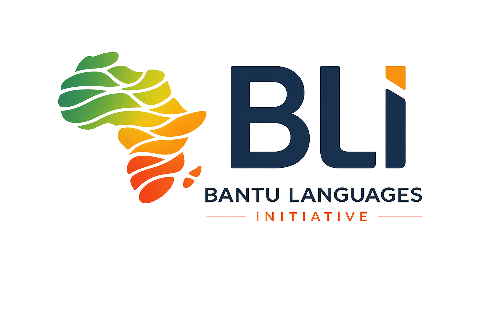
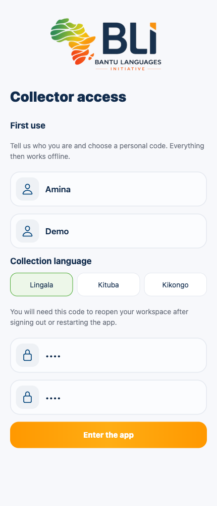
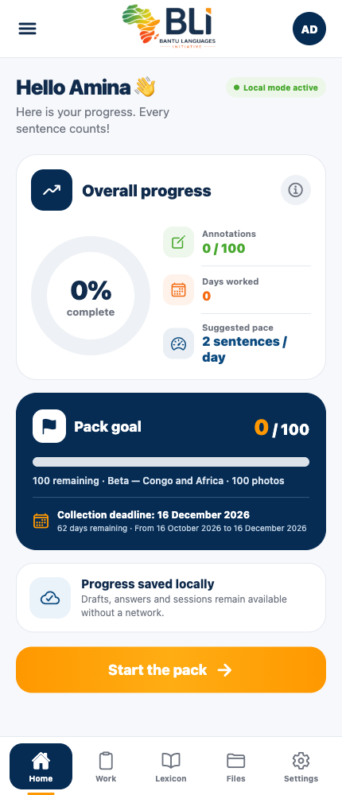
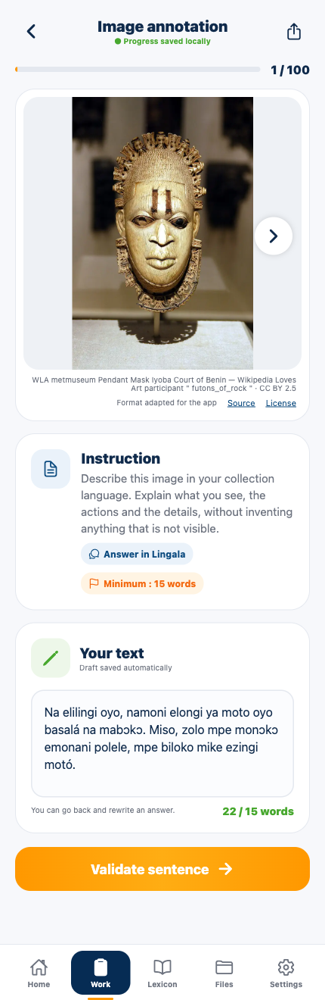
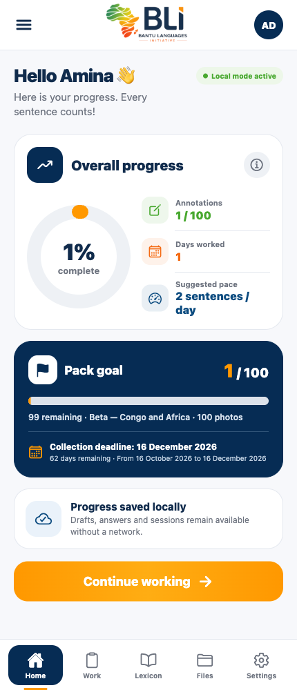
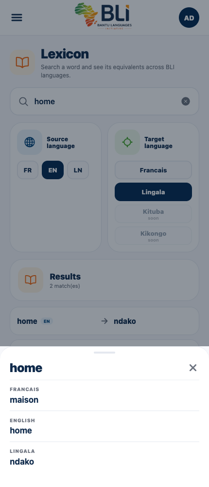
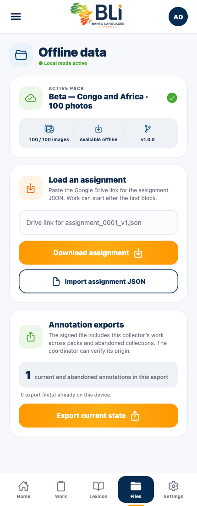

  

# BLI Collect

**Describe images in your language. Help build a corpus for African languages. Work wherever you are.**

BLI Collect is a field collection app from the **Bantu Languages Initiative**. Collectors write descriptions in **Lingala, Kituba or Kikongo**, keep their work on their phone, and share it with their coordinator when they are ready.

The **0.4.0 beta** includes **100 photos from Congo and across Africa**, ready to use offline, plus a French–English–Lingala dictionary. You can create your own local account: no invitation code or external approval is needed.

[Your first collection](#your-first-collection) · [Upcoming](#upcoming) · [Technical details](docs/TECHNICAL_README.md)

## Get the app

For the Android beta, use the **Google Play testing invitation provided by your BLI coordinator**, with the Google account enrolled in the test. Install the app before going into the field; the included photos are already on the phone.

Developers can [run the project locally](docs/TECHNICAL_README.md#run-locally).

## Your first collection

**Create your access → open a photo → write → validate → export and share.**

The screenshots below show the real 0.4.0 Web preview at a phone-sized width, using a fictional collector, **Amina Demo**. English is preselected for these illustrations, including the access screen, and the instructions use English button names. A fresh installation starts in French; after signing in, select **Réglages → English** to use the English interface. On a phone, exporting opens the native sharing options.

### 1. Create your access and start a pack

On the welcome screen, tap **Get started**. Enter your first and last names, select your collection language, then choose and confirm a **personal code of 4–12 digits**. Tap **Enter the app** to enter.

The app creates your collector ID automatically. Your personal code lets you reopen your workspace after signing out or restarting the app.

On **Home**, check your progress and tap **Start the pack**. The 100-photo beta pack is ready without a download.

<table>
  <tr>
    <th>Create your local access</th>
    <th>Start with the included photos</th>
  </tr>
  <tr>
    <td valign="top"></td>
    <td valign="top"></td>
  </tr>
</table>

### 2. Describe, validate and continue

Read the prompt under the photo and describe what you can actually see, **in your chosen collection language**. For the beta pack, write at least **15 words**; the word counter helps you check.

Your draft is saved automatically. Tap **Validate sentence** when it is ready: your progress increases and the next unfinished image opens. Use the image arrows to revisit and edit a response.

You can stop and come back later. From Home, **Continue working** takes you back to your collection. You do not have to finish all 100 photos in one sitting.

<table>
  <tr>
    <th>Write a description</th>
    <th>See your progress</th>
  </tr>
  <tr>
    <td valign="top"></td>
    <td valign="top"></td>
  </tr>
</table>

### 3. Look up a word, then export your work

Need a word? Open **Lexicon**, choose the source and target languages, and search. Tap a result to see its translations. The dictionary works offline and currently covers French, English and Lingala; Kituba and Kikongo entries are planned.

To hand over your work:

1. Open **Files** and find **Annotation exports**.
2. Check the number of annotations included, then tap **Export current state**.
3. On your phone, choose where to save or share the generated **JSON file**. Send that file to your coordinator using the agreed channel, such as WhatsApp or email, when a connection is available.

**You can export before finishing the pack.** The file includes your non-empty drafts and validated responses, including work from earlier packs. Exporting keeps your work in the app, so you can continue collecting and export again later.

<table>
  <tr>
    <th>Find a word offline</th>
    <th>Export your collection</th>
  </tr>
  <tr>
    <td valign="top"></td>
    <td valign="top"></td>
  </tr>
</table>

## Everyday use

- **Returning to your work:** enter your personal code. If several people use the same phone, choose your name first.
- **Forgotten code:** tap **Forgotten code**, enter the same first and last names used at registration, and choose a new code. Spelling and accents must match; your work is kept.
- **A new assignment:** in **Files**, paste the assignment link supplied by your coordinator or import its JSON file. Download the photos while connected; then work offline. See [pack preparation](docs/TECHNICAL_README.md#prepare-a-collection-pack) for coordinators.
- **Interface language:** open **Settings** to change the interface language or theme. The interface returns to French at startup and sign-out. Your collection language stays attached to your account.
- **Keeping a copy:** save or send exports regularly. Work is stored on this phone; there is currently no automatic online backup or account synchronization between devices.

## Upcoming

Planned improvements, **not yet available in this beta**:

- **Audio recording** to collect spoken responses alongside written descriptions.
- **Double annotation** so two collectors can independently describe the same item, with both contributions preserved for comparison.
- **Review and reconciliation** to help coordinators assess annotations and resolve differences.
- **Server-based account verification and synchronization**, while preserving the ability to collect offline.
- **More language resources**, including Kituba and Kikongo dictionary entries and prompts reviewed by speakers.

## For coordinators and developers

The [Technical README](docs/TECHNICAL_README.md) explains local development, the accepted pack and assignment formats, local storage, exports and Android builds.

Photos retain their individual licenses and attribution. See the [complete photo credits](docs/beta-photo-sources.md), including the Iyoba mask shown in this guide. The screenshot account and annotation are demonstration material, not collected research data.
