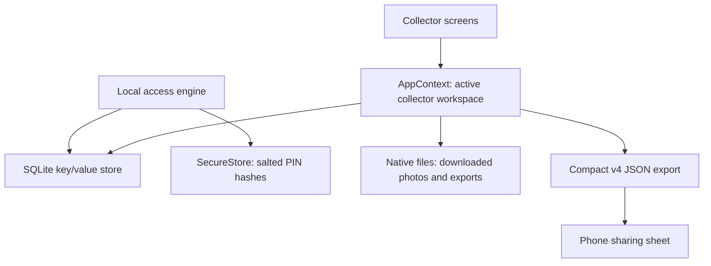

# BLI Collect — Technical details

[Back to the illustrated user guide](../README.md)

This document describes **version 0.4.0**: local development, preparing collection packs, storage and exports. BLI Collect uses Expo SDK 57, React Native 0.86, React 19 and TypeScript. Native persistence uses SQLite and SecureStore. There is currently **no application backend**, account synchronization or automatic remote backup.

## Contents

- [Run locally](#run-locally)
- [Prepare a collection pack](#prepare-a-collection-pack)
- [Prepare an assignment](#prepare-an-assignment)
- [Downloads and installation](#downloads-and-installation)
- [Local storage](#local-storage)
- [Collector access](#collector-access)
- [Export format](#export-format)
- [Bundled photos and dictionary](#bundled-photos-and-dictionary)
- [Checks and Android builds](#checks-and-android-builds)
- [Project map](#project-map)

## Run locally

Use Node.js and npm; Node 24 was used for the local workflow. From the repository root:

```sh
npm ci
npm start
```

For a phone on the same network:

```sh
npm start -- --lan
```

Scan the QR code with an Expo Go version compatible with this project's **SDK 57**, or use an appropriate development build. A mismatched Expo Go SDK cannot open the project. The local development server serves the app; it is not an account or collection-data server.

For a browser preview:

```sh
npm run web
```

`npm run android` and `npm run ios` ask Expo to open a connected device or an installed emulator/simulator. The corresponding platform tools must already be available.

### What the Web preview can validate

The browser is useful for layout, registration screens, the bundled photo workflow and dictionary navigation. It has different storage boundaries:

| Capability | Android / iOS | Web preview |
| --- | --- | --- |
| Collection state | SQLite key/value store | AsyncStorage's browser adapter |
| Local accounts and PIN records | Persistent SQLite + SecureStore | In memory; lost on page reload |
| Assignment ZIP installation | Native file storage | Not supported |
| Export file creation and sharing | Native file system and sharing sheet | Not a supported end-to-end export path |

Validate persistence across app restarts, SecureStore, assignment imports and export sharing **on a phone**. Do not use the Web preview as a field collection installation.

## Prepare a collection pack

A **pack** is a ZIP archive containing image files and a manifest. An **assignment** is a separate JSON document that tells the app which ZIPs and items to download and in what order.

### Accepted format in 0.4.0

**Use `schemaVersion: 1` for the ZIP's `manifest.json`.** The current runtime validator in [assignmentFiles.ts](../src/services/assignmentFiles.ts) rejects `schemaVersion: 2`, although the TypeScript type and the older [pack example](pack-manifest.example.json) describe v2. That older example therefore needs its schema number changed before use with 0.4.0.

The validator already accepts the multilingual `prompts` and per-language `minWords` fields shown below under **schema 1**. The older single-prompt form, `question` with a numeric `minWords`, is also accepted. This guide records the current behavior; it does not change the importer.

### 1. Organize the files

```text
pack_0001/
├── manifest.json
└── images/
    ├── image_0001.webp
    └── image_0002.jpg
```

Use WebP, JPEG or PNG. Paths in the manifest must start with `images/`, match the archive exactly and stay inside the archive. Absolute paths and `..` path segments are rejected. Keep photos small enough for entry-level phones and retain the source, author and license.

### 2. Write manifest.json

This one-image example can be expanded with more items. Supply prompts reviewed by speakers of each collection language you distribute.

```json
{
  "schemaVersion": 1,
  "packId": "pack_0001",
  "version": 1,
  "name": "Lot 0001 — scènes de vie quotidienne",
  "nameEn": "Pack 0001 — everyday life scenes",
  "languages": ["ln", "ktu", "kg"],
  "items": [
    {
      "id": "pack_0001_item_0001",
      "image": "images/image_0001.webp",
      "prompts": {
        "ln": "Lobá na ntína ya elɔ́kɔ ya libosó ozali komóna na elilingi oyo.",
        "ktu": "Tubila kima ya ntete ya nge ke mona na kifwanisu yayi.",
        "kg": "Tubila lekwa dia ntete oyo omweni mu kifwaniswa kiaki."
      },
      "minWords": { "ln": 15, "ktu": 15, "kg": 15 },
      "credit": "Replace with the actual author and license",
      "metadata": {
        "source": "production",
        "category": "daily_life"
      }
    }
  ]
}
```

| Field | Contract |
| --- | --- |
| `schemaVersion` | `1` in the current runtime |
| `packId`, `version` | Must match the corresponding assignment reference; version may be a string or number |
| `name` | Required pack name; `nameEn` is optional |
| `languages` | Optional non-empty list drawn from `ln`, `ktu`, `kg` |
| `items[].id` | Stable, unique ID; also unique across all packs selected into one assignment |
| `items[].image` | Relative path to an existing image inside `images/` |
| `items[].prompts` | Non-empty map of collection-language codes to non-empty prompts |
| `items[].question` | Legacy single prompt, accepted when `prompts` is absent; optional `instructionEn` supplies its English interface fallback |
| `items[].minWords` | Positive integer or non-empty language-to-positive-integer map; supply a value for every distributed language |
| `credit`, `metadata` | Optional attribution and dataset metadata; include them for traceability |

When installing a multilingual pack, the app keeps only the prompt for the collector's language in the collection state. Items without a matching prompt can be filtered out and cause a count mismatch; a selection with no usable items fails with `LANGUAGE_NOT_AVAILABLE`. Ensure **every selected item** supports the intended language. A legacy item with only `question` is treated as usable through its fallback prompt.

### 3. Create the ZIP and its checksums

Run these commands **inside** the pack directory so `manifest.json` is at the archive root, not inside an extra wrapper folder:

```sh
zip -r ../pack_0001_v1.zip manifest.json images
shasum -a 256 ../pack_0001_v1.zip
wc -c < ../pack_0001_v1.zip
```

Record the SHA-256 hex digest and exact byte count for the assignment. Use a standard, unencrypted ZIP with stored or Deflate-compressed entries. ZIP64, multi-volume and password-protected archives are not supported.

## Prepare an assignment

The app imports an **assignment JSON**, not a loose image, CSV, export JSON or directly selected ZIP. See also [assignment-manifest.example.json](assignment-manifest.example.json).

```json
{
  "schemaVersion": 1,
  "assignmentId": "assignment_0001",
  "version": 1,
  "targetItems": 1,
  "language": "ln",
  "packs": [
    {
      "packId": "pack_0001",
      "version": 1,
      "source": {
        "provider": "https",
        "shareUrl": "https://example.org/bli/pack_0001_v1.zip"
      },
      "include": "all"
    }
  ],
  "sequence": [
    { "packId": "pack_0001", "itemId": "pack_0001_item_0001" }
  ]
}
```

Replace the example URL with a real, accessible download. Add `sha256` and `sizeBytes` to each entry in `packs` using the values calculated from the final ZIP. Both fields are optional in the parser; providing them enables the applicable integrity checks, size checks and more useful download progress. A digest must contain exactly 64 hexadecimal characters; a size must be positive.

- **Schema:** assignments require `schemaVersion: 1`, an `assignmentId`, a `version`, a positive integer `targetItems`, and at least one pack. Do not repeat a `packId` within an assignment.
- **Language:** optional `language` is `ln`, `ktu` or `kg`. When present, it must match the intended collector account. Omit it to use the collector's language and provide all required prompts.
- **Hosting:** use `provider: "https"` for a direct HTTPS file URL, or `"google-drive"` with a Drive sharing link. Both the assignment JSON and ZIPs must be accessible without an interactive sign-in; the app does not perform Drive OAuth.
- **Selection:** `sequence` defines explicit item order across packs and takes precedence over `include`. Without a sequence, each pack's `include` may be `"all"`, an array of item IDs, or omitted to include all items.
- **Counts:** without a sequence, the installed selection must contain exactly `targetItems` items. With a sequence, the installed count must match the sequence length; that length may be smaller than `targetItems` for a staged or test assignment. The overall goal remains `targetItems`.
- **Updates:** publish a new version when changing a pack and update the assignment reference. Installation directories are keyed by assignment, pack and version; a previously installed version can be reused.

Upload the ZIP, then publish the assignment JSON referencing it. Give the collector either the JSON's HTTPS/Drive link or the JSON file itself. In **Fichiers**, they choose **Télécharger l’affectation** or **Importer une affectation JSON**. Importing a local JSON still needs a connection to download ZIPs that are not already installed.

Manifests do not define the collection calendar. The app starts a two-calendar-month collection period at the collector's first local login.

## Downloads and installation

ZIPs are downloaded and installed sequentially; collection can begin after the first block is available. Only selected images are extracted. A completed installation gets a `.complete` marker, and its downloaded ZIP is removed after success. A fully downloaded ZIP is retained after an installation failure so retrying can reuse it.

When the host supports byte ranges, downloads use 2 MiB chunks and persist progress in a `.part.json` file. Otherwise, the downloader uses the platform's resumable transfer where available. A changed expected file size invalidates stale partial data.

If supplied, the full ZIP SHA-256 is checked for archives up to **256 MiB**. Larger archives skip that full-file hash pass; entries actually read are checked with their ZIP CRC. CRC and an unsigned hash are corruption checks, not proof of the publisher's identity.

Current limits in [assignmentFiles.ts](../src/services/assignmentFiles.ts):

| Limit | Value |
| --- | --- |
| Items in a source pack | 20,000 |
| Selected items per installed pack | 10,000 |
| Manifest size | 16 MiB |
| Compressed or uncompressed bytes per selected image | 64 MiB |
| Total selected uncompressed image bytes per extraction | 4 GiB |
| Free-space estimate when ZIP size is supplied | ZIP size × 1.75, plus 50 MiB |

These are parser limits, not recommended field pack sizes. Prefer smaller packs for low-storage phones and unreliable connections.

| Error code | What to check |
| --- | --- |
| `INVALID_ASSIGNMENT` | Assignment schema, references, digest format and selection |
| `INVALID_PACK_MANIFEST` | Schema number, pack ID/version, item paths and prompts |
| `LANGUAGE_NOT_AVAILABLE` | Prompts for the selected collection language |
| `ASSIGNMENT_ITEM_NOT_FOUND` / `DUPLICATE_ITEM_ID` | Item references and uniqueness |
| `ASSIGNMENT_ITEM_COUNT_MISMATCH` | Selected count, sequence and `targetItems` |
| `NOT_ENOUGH_SPACE` | Free device storage |
| `DRIVE_ACCESS_DENIED` / `DRIVE_QUOTA_EXCEEDED` | File sharing permissions or download quota |
| `DOWNLOAD_RATE_LIMITED` / `NETWORK_UNAVAILABLE` | Hosting throttling or connectivity; retry when available |
| `MOBILE_STORAGE_REQUIRED` | Run the import on Android or iOS |

## Local storage

SQLite is used as a **key/value store**, not as one relational table per annotation. The app serializes the collection state as a JSON document. Photos live in bundled assets or in the device file system; they are referenced by the state.



| Location | Content |
| --- | --- |
| SQLite key `@bli-collect/state/v4` | `AppState`, with `schemaVersion: 4` |
| SQLite key `@bli-collect/auth/v2` | Public account registry: version, accounts, selected collector code |
| SecureStore key `bli.pin.<collectorCode>` | `{ kdf: "sha256-v1", salt, hash }`; never the plaintext PIN |
| Document directory `bli-packs/assignments/<assignment>/<pack>-v<version>/` | Selected images, filtered manifest and completion marker |
| Cache directory `bli-<assignment>-<pack>.zip` and `.part.json` | Downloaded archive and resumable transfer state |
| Document directory `bli-exports/` | Generated JSON exports |

The main state shape is defined in [src/types.ts](../src/types.ts):

| Field | Purpose |
| --- | --- |
| `installationId`, `onboardingCompleted` | Installation identity and first-run state |
| `profile` | Currently selected collector profile, or `null` |
| `profileWorkspaces` | Per-profile annotations, sessions and active session, retained when switching collectors |
| `collectionClocks` | Per-profile collection start and last trusted local timestamp |
| `preferences` | Interface language and theme |
| `pack`, `assignment` | Active items and assignment download/installation progress |
| `packRegistry` | Pack metadata needed to export earlier work |
| `annotations` | Active workspace map keyed by `packId:language:itemId` |
| `sessions`, `activeSessionId` | Work sessions and the current position |
| `abandonedCollections` | Archived collections retained for export |

Collector identity is based on the **collector code**, never the person's name. Profile workspaces isolate people sharing a phone. The annotation key includes the collection language to keep answers in different languages separate. A downloaded assignment becomes the active pack under its `assignmentId`; item `originPackId` retains the source ZIP's pack identity.

Changes update in-memory state and persist it; draft saves are debounced and pending state is flushed when the app moves to the background. Closing an app at an arbitrary instant is not a replacement for regularly exporting a copy.

### Migrations

[storageState.ts](../src/services/storageState.ts) normalizes older state into schema 4. Native loading also checks legacy AsyncStorage keys. Migrations must preserve profiles, annotations, sessions, collection clocks and installation identity.

Older profiles without a collector code are migrated using their username as a free-form code and a Lingala default. Review such historical data before including it in a language-specific corpus. Replacing the old demo pack with the beta pack retains its annotations. Updating an installation with an active downloaded pack keeps that pack active.

## Collector access

The 0.4.0 beta uses a **trust-based local account**:

1. Registration takes first name, last name, collection language and a 4–12 digit PIN.
2. The app generates a `BLI…` collector code and stores a salted SHA-256 PIN hash using a cryptographically secure random salt.
3. A new app runtime or sign-out requires unlocking again. Switching between apps keeps the in-memory session while the runtime survives.
4. Forgotten-PIN recovery matches the registration names, then replaces the PIN while retaining the collector code and work. Matching ignores case, repeated spaces and composed/decomposed Unicode differences; it preserves spelling and accents.

This is local access control, **not identity verification by BLI**. Someone who knows the registered names can use the recovery path. A server-based verification system is planned. The signed authorization files and coordinator authority tool from 0.3.0 were deliberately removed; do not use that old setup for 0.4.0.

Existing 0.3.0 accounts retain their collector codes and data and choose a new PIN through the recovery screen. The public legacy registry `@bli-collect/auth/v1` is read for migration.

The engine in [src/auth/engine.ts](../src/auth/engine.ts) is independent of native APIs; storage and randomness are injected. The native adapter uses SQLite and SecureStore, and the runtime uses `expo-crypto.getRandomValues` for randomness.

## Export format

Exports are plain UTF-8 JSON documents in **compact format v4**. The structural example is [export.example.json](export.example.json); the implementation is [dataFiles.ts](../src/services/dataFiles.ts).

```text
bli_<collector-code>_<language>_<active-pack>_<timestamp>.json
```

The filename references the active pack, but the content can include **multiple packs**. Exporting is a snapshot and does not remove local work. Non-empty drafts and validated responses are both included, so downstream processing must inspect each annotation's `status`.

| Field | Meaning |
| --- | --- |
| `v`, `app`, `at` | Format version (`4`), app name and export time |
| `build` | App version, platform, available device information and installation ID |
| `collector` | Collector code, name, language and collection timestamps |
| `collections[]` | One block per pack and collection language; `kind` is `current`, `previous` or `abandoned` |
| `collections[].pack` | Pack identity, version, goal and the language represented by this block |
| `collections[].sessions` | Session timing, status, language and position |
| `collections[].annotations` | Text, word count, draft/validated status, timestamps, source metadata and typing metrics |
| `totals` | Collection count, non-empty annotation count, validated count and word count |
| `integrity` | SHA-256 of the serialized body without `integrity`, plus its UTF-8 byte count |

Typing metrics include active typing time, delay to first input, edit events, deletions and the largest text insertion (`maxBurstChars`). They can support quality review; a large insertion alone does not establish how or by whom a response was composed.

Only the connected collector's workspace and their archives are exported. Photo binaries and PIN records are not included. Preserve the JSON as a file when transferring it; a screenshot or a message containing copied text is not the export.

### Verify file integrity

Save the following as a local inspection script and pass an export path as its first argument. It uses the same JSON serialization as the app:

```js
const fs = require('node:fs');
const { createHash } = require('node:crypto');
const assert = require('node:assert/strict');

let document = JSON.parse(fs.readFileSync(process.argv[2], 'utf8'));
if (document.format === 'bli-signed-export') document = document.payload;
const { integrity, ...payload } = document;
const body = Buffer.from(JSON.stringify(payload), 'utf8');
assert.equal(integrity.algorithm, 'sha256');
assert.equal(body.length, integrity.bodyBytes);
assert.equal(createHash('sha256').update(body).digest('hex'), integrity.value);
console.log('Integrity OK');
```

The optional wrapper handling only extracts the payload of historical 0.3.0 files; it **does not verify their old signatures**. Current 0.4.0 files have no signed wrapper. The integrity hash detects corruption, not authorship or tampering by someone who recomputes the hash. The Files screen still contains older wording about a “signed file”; that label does not describe the current export implementation.

Exclude the historical `bli-demo-iyoba` pack from research ingestion unless separately reviewed: its prompts were draft material. The bundled `bli-beta-congo-100` items use `metadata.source: "beta"` and should follow the beta campaign's validation process before corpus inclusion.

## Bundled photos and dictionary

### Photos

The default `bli-beta-congo-100` pack contains the original Iyoba mask and 99 additional Wikimedia Commons photos. The 100 optimized WebP images are bundled for offline use. The beta prompt follows the interface language (French or English), while the answer remains in the collector's chosen language; its minimum is 15 words.

Edit the photo registry in [beta-photo-sources.json](beta-photo-sources.json), retain source URLs, authors, licenses and modification notes, then run:

```sh
npm run build:beta-photos
npm run test:beta
```

The generator updates static Expo image references and the [readable credits](beta-photo-sources.md). Attribution is also shown on the work screen; opening external source/license links requires a connection.

### Dictionary

The source is [lexicon/dictionnaire_francais_english_lingala.csv](../lexicon/dictionnaire_francais_english_lingala.csv). The app loads the generated [lexiconEntries.json](../src/data/lexiconEntries.json), currently containing 2,017 entries. Edit the CSV, then regenerate:

```sh
npm run build:lexicon
npm run test:lexicon
```

The builder handles quoted CSV fields, removes empty rows and exact duplicates, and recognizes language headers. Kituba and Kikongo are declared but have no current entries; adding their columns and data activates them. Do not edit the generated JSON manually or strip Lingala accents.

The search engine in `src/services/lexicon/` preserves displayed spelling, maintains an accent-sensitive search index and ranks exact, prefix and approximate matches. It is initialized when the dictionary is opened. An exact match is not padded with unrelated spelling suggestions; no correction is imposed automatically.

## Checks and Android builds

Run the repository checks before proposing changes:

```sh
npm run typecheck
npm run test:auth
npm run test:beta
npm run test:lexicon
```

`npm run check` runs these checks and a Web export. Test scripts run without network access; the real native workflow still needs a phone. See [AGENTS.md](../AGENTS.md) for contribution rules.

| Command | Purpose |
| --- | --- |
| `npm start` | Start Expo development server |
| `npm run web` | Open Web preview |
| `npm run typecheck` | Check TypeScript |
| `npm run test:auth` | Registration, unlocking, recovery, account isolation and migration |
| `npm run test:beta` | Bundled photos, state migration and export continuity |
| `npm run test:lexicon` | Dictionary normalization, search and performance |
| `npm run build:beta-photos` | Regenerate bundled-photo references and credits |
| `npm run build:lexicon` | Regenerate dictionary data from CSV |

For Google Play, build an **AAB**, with the `production` EAS profile. On the configured Mac, Java 17 and the Android SDK are used for local builds:

```sh
export JAVA_HOME="/opt/homebrew/opt/openjdk@17/libexec/openjdk.jdk/Contents/Home"
export ANDROID_HOME="$HOME/Library/Android/sdk"
export ANDROID_SDK_ROOT="$ANDROID_HOME"
export PATH="$JAVA_HOME/bin:$PATH"
mkdir -p dist-android
npx eas-cli@latest build --platform android --profile production --local --output dist-android/BLI-Collect-0.4.0-google-play.aab
```

Adapt the Java/SDK paths on other machines. Local compilation still needs internet for dependencies, EAS signing credentials and the remotely managed version counter. Allow roughly 10 GB of free working space. The `preview` profile produces an APK for direct installation; neither profile automatically publishes to Google Play.

Keep `package.json` and `app.json` versions synchronized. Preserve Android package **`com.bantulanguagesinitiative.bli_collect`** and the existing EAS signing key. Android `versionCode` is managed remotely by EAS and incremented by the production profile. See [beta-0.4.0.md](beta-0.4.0.md) for campaign and Play Console steps; [beta-0.3.0.md](beta-0.3.0.md) is historical.

## Project map

```text
App.tsx                 Welcome, access and main-screen navigation
src/auth/               Local account engine and platform adapters
src/state/AppContext    Collector workspaces, sessions and persistence
src/screens/            Home, Work, Files, Dictionary and Settings
src/services/           Storage, migrations, downloads, imports and exports
src/data/               Bundled pack, photo references and generated dictionary
src/utils/              Collector codes, languages and annotation keys
scripts/                Offline checks and content generators
docs/                   Formats, credits, beta notes and screenshots
lexicon/                Source dictionary CSV
images/beta/            Bundled WebP photos
```

Do not commit build outputs, dependency folders, signing credentials, private keys or real collector exports. Use a branch per subject and a pull request; code, comments and commit messages follow the repository's French conventions.
